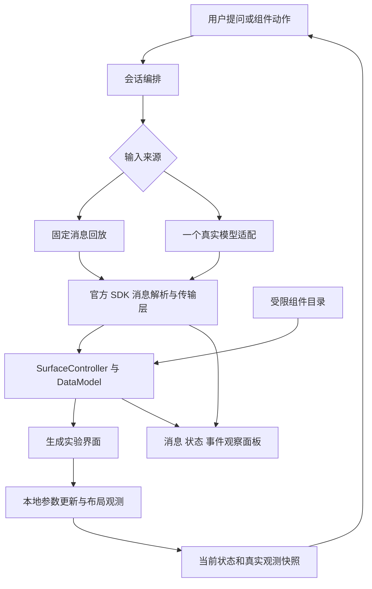

# Forge 生成式实验工作区规划

2026-10-23 最新澄清：用户希望把 GenUI 融入 Forge 的模块检索与选择，通过真实项目改造理解其能力，而非建设知识库、完整课程或 Agent 应用。当前目标为“表达学习意图 → 模型组织已有模块的推荐与交互 → 用户选择 → 现有路由进入模块”。详见 [当前改造范围](GENUI_ENGINEERING_LEARNING_PLAN.md)。此前独立教学推演与跨场景训练不再作为先决步骤；本文其余内容保留首期约束实验的实现背景。

后续已批准的跨项目能力与工作流基建见 [Forge × Agent Hub 工作流基建](WORKFLOW_ECOSYSTEM_FOUNDATION.md)，与本页的首期真实模型实验分开验收。

日期：2026-10-22。状态：首个约束场景已实现；固定回放、macOS 真实 Codex 三轮闭环与配置表单已验收，平台范围及后续产品验证见 [实施记录](reports/GENUI_WORKBENCH_IMPLEMENTATION-20261022.md)。

## 1. 已确认的目标

产品主轴已经确认：使用者打开 Forge，首先表达「我现在想探索什么问题」，系统围绕该问题组织可操作的实验工作区。主要使用者是项目作者，同时为访客提供容易理解的体验入口。

通过真实项目改造掌握 Flutter 官方 GenUI SDK，是实施过程中的学习目标。独立模块是首期验证载体，后续方向是 Forge 的可选择新入口；教学说明为探索提供帮助，不要求使用者先完成课程。

当前项目仅有部分交互场景，后续逐渐完善。首期使用一个约束小实验验证「问题 → 生成工作区 → 操作 → 真实观测 → 继续调整」；不要求深入比较不同场景或建设自适应教学系统。

已确认的方向：官方 SDK 优先；先用预设组件和受限动作，后续逐步组合；解释对应实际状态。首期同时验证实际探索体验与组件目录、生成消息、状态绑定、事件回传的技术链路。

整体框架演进纳入后续路线，首期不替换默认首页。跨模块能力组合、任意代码生成与执行、多模型适配、学习者画像、掌握度评估、长期实验恢复不属于首期验收条件。

## 2. 产品结构与改造原则

| 层次 | 职责 | 生成边界 |
| --- | --- | --- |
| 稳定应用框架 | 窗口、导航、主题、会话入口与错误恢复 | 继续由明确的应用代码管理 |
| 生成式实验工作区 | 理解问题，选择说明、控件、预览与日志，并组织后续操作 | 模型在受限组件目录内选择、组合和更新 |
| 确定执行的实验能力 | 校验参数、执行动作、返回状态与真实观测 | Flutter 代码执行，模型不能编造结果 |

首期先在一个独立入口内验证中间一层，能力与编排保持职责分离，但不为未来场景提前建设通用平台。后续升级为应用入口时，应用层负责组合能力；模块之间仍不直接依赖。

固定搜索保留明确的模块定位能力；生成式入口负责组织当前问题的探索过程。既有目录作为可靠入口继续可用。只有当动态组织确实减少找入口、调参数、切换视图与联系现象的成本，才扩大其在整体框架中的职责。

## 3. 当前源码基础与接入位置

规划最初基于 `eb500f5` 的 dev 工作区。实施期间，外部操作将导航与原生窗口改动提交为 `b501f21`，本模块验证以该 HEAD 加本轮未提交实现为准，不作为发布验收依据。

| 已有基础 | 规划中的用途 |
| --- | --- |
| `apps/flutter_forge/lib/module_registry/module_entry.dart` | 复用标题、简介、难度、概念、时长和平台支持元数据 |
| `apps/flutter_forge/lib/shared/learning/learning_scaffold.dart` | 复用学习目标、概念、代码说明和练习等教学组件 |
| `apps/flutter_forge/lib/modules/basic/constraint_layout/pages/constraint_layout_page.dart` | 参考约束演示的交互方式，不跨模块引用其私有状态或页面 |
| `tool/generate_agent_indexes.js` | 新增模块声明，统一生成注册、路由和机器契约 |
| `tool/agent_indexes/availability.js` | 根据实际 SDK 与模型适配依赖审查能力，推导平台策略 |

建议注册信息如下，实施时以生成源为准：

- 目录：`apps/flutter_forge/lib/modules/ui/genui_workbench/`。
- 标题：`生成式实验工作区`。
- 简介：`提出一个技术问题，使用 GenUI 组织可操作实验，观察结果并继续探索。`
- 分类：`ModuleCategory.ui`，沿用「UI 与动效」，不新增分类。
- 入口：`module_entry.dart` 导出 `GenuiWorkbenchEntry`。
- 稳定路由：`/genui-workbench`。
- 难度：`Difficulty.intermediate`；预计学习时间：30 分钟。
- 概念：`GenUI`、`A2UI`、`Catalog`、`Surface`、`DataModel`、`交互事件`。
- 实施阶段为 `ModuleStatus.pending`；满足可学习验收后再改为 `ready`，不因 SDK 接通直接标记 `recommended`。

上述元数据已随有实际交互的原型进入生成源；固定回放、真实闭环和定向测试通过后已调整为 `ready`，不声明所有平台均已验收。生成文件由流水线更新。

## 4. 首个场景：生成一个约束小实验

场景用于验证问题驱动的工作区，也帮助实现者理解 GenUI。旧规划中的 `genui_learning` 与 `/genui-learning` 尚未落地，本次统一改为上述命名，不需要建立旧路由兼容。

1. 使用者输入「为什么子组件设置了宽度却没有生效」，或选择一个示例问题。
2. SDK 根据结构化消息渲染说明、参数控件、布局预览和操作按钮。
3. 使用者改变父约束、子组件期望宽度或松紧模式，预览立即响应。
4. 页面显示实际约束、期望尺寸和真实布局后的尺寸。实际尺寸从 Flutter 布局结果采集，不以模型文本或公式预测冒充实测。
5. 使用者点击「解释当前结果」或追问「换成紧约束看看」，发送当前状态、观测值和来源标识；模型解释或调整当前实验。
6. 界面局部更新时保留未被明确修改的参数与当前操作位置，避免每轮都丢弃实验重新开始；支持显式重置或重开会话。

首期只覆盖一个子组件、松/紧约束与少量尺寸参数。固定预设覆盖「松约束」「紧约束」「改变期望宽度」三种状态，不建设多场景对比系统。自由输入可以提出请求，但仅承诺组件目录表达范围内的实验。

首次进入明确说明：「当前仅支持约束小实验，交互能力将逐步完善。」超出范围时说明可做什么，保留当前实验。

## 5. 页面体验与 SDK 学习辅助

主流程优先呈现问题输入、当前实验与结果。首次进入提供能力范围和示例问题；已有实验时围绕它继续操作。生成界面占主要空间，对话用于表达意图和追问，不把实验压缩成狭小的聊天附件。

教学步骤、代码和协议观察为可展开的辅助内容，使用者无需先读完这些内容才能操作实验。实现者仍按以下顺序学习 SDK：

| 学习步骤 | 动手内容 | 学会什么 |
| --- | --- | --- |
| 1. 界面来自哪里 | 用固定消息创建、更新、删除一个 Surface | 运行时描述与预写 Widget 的关系 |
| 2. 模型能用什么 | 查看并修改一个 CatalogItem 的属性 schema 与 builder | Catalog 是受约束组件目录 |
| 3. 状态如何更新 | 拖动参数，观察绑定路径与预览同步 | DataModel 与本地交互的关系 |
| 4. 操作如何回传 | 点击解释，观察动作和状态快照 | 从组件事件到下一轮请求的闭环 |
| 5. 接入真实模型 | 发出提示、接收流式消息并操作生成界面 | 模型适配与 SDK 渲染的边界 |

两种运行模式使用同一 SDK 渲染链路和组件目录：

- **教学回放**：固定、版本匹配的消息输入 SDK；可无模型配置学习和复现事件。界面持续标注「固定消息回放，未调用模型」。回放的后续响应也是预设，不能宣称模型推理成功。
- **真实生成**：一个真实模型接入，显示配置与请求状态。未配置时提供说明，失败时允许重试或显式切换回放；不自动以回放结果冒充真实响应。

桌面宽窗口中，输入与当前问题置于辅助区；「消息 / 状态 / 事件」观察面板默认可折叠。窄窗口按问题、实验、结果与辅助内容纵向排列，不添加新的应用级底部导航。

观察面板服务于本模块的 SDK 学习，展示当前运行真正产生的数据；代码卡注明「当前实现片段」或「概念示意」，不能把示意代码标成可直接运行的当前 API。

## 6. 技术方案与边界



链路图表达职责，不冻结尚未编译核对的具体 API。组件目录首期只提供说明、受限布局、数值控制、模式选择、约束预览、观测结果和动作按钮；优先复用锁定版本的标准组件，自定义实现只补约束预览等领域能力。避免把每个教学块封装成大型固定页面，导致模型只选择整页而无法学习组合。

- 模块内管理会话、传输适配、目录、固定消息和观察状态；首期不抽取新的共享包或通用 Agent 框架。
- 不引用其他业务模块；最小约束预览在本模块实现。未来确有多个消费者再评估提取业务无关能力。
- 数值范围、枚举、组件类型、允许动作和消息大小有边界；无法识别的组件或无效消息呈现错误，不执行模型返回的 Dart、脚本或任意外部动作。
- 参数拖动与 Flutter 布局本地即时完成，不在每一帧调用模型。解释/重新生成等显式动作才发出请求。
- 真实尺寸带观测版本；等待当前布局完成后才发送解释请求。解释标记对应的状态版本，参数改变后提示解释已过期。
- 生成中允许取消；重置、切换模式、离开页面后，旧请求的迟到结果不得覆盖新会话；释放流订阅、控制器与监听。
- 观察记录有数量与内容长度上限；记录协议消息和实验状态，不记录鉴权信息。
- 首期仅同会话保留实验，不增加最近访问的任务恢复语义。

建议文件按实际复杂度建立，避免提前铺空层：

```text
genui_workbench/
  module_entry.dart
  genui_workbench_page.dart
  genui_session.dart              # 会话、取消、重置、生命周期
  catalog/                       # 目录与约束预览
  transport/                     # 回放与一个真实模型适配
  lessons/                       # 学习步骤、提示与版本匹配的消息
  widgets/                       # 观察面板等模块内部 UI
  AI_ANALYSIS.md                 # 由生成器生成
```

## 7. SDK、模型与平台决策

2026-10-22 在线核查时，pub.dev 显示 `genui 0.10.4`，官方仍将 SDK 标记为 alpha。这是候选基线，不表示已在本仓库解析或运行通过。

官方概览与包 README 中可见 `sendMessage` / `sendRequest`、消息更新名称等差异；事件说明中也出现旧架构术语。实施必须以最终锁定包的源码、测试及匹配版本示例为准，教学材料不能混用不同版本 API。升级 SDK 作为明确变更处理。

真实模型适配首期只接一个。用户目前只有 Codex Team，实施采用可连接本机 Codex CLI 开发桥接的 HTTP/SSE 适配；桥接使用 CLI 自身已有登录，不由 Forge 读取登录凭据。该路径不表示取得通用 API 额度，也不保证某个模型可用，仍需真实请求验收。不创建云资源。

本机桥接作为独立开发进程运行，带临时访问令牌，仅监听回环地址；模型名 `codex-default` 使用 CLI 默认模型，也可显式指定可用模型。Bridge 先取得 Codex 最终结果，再通过 SSE 分块交付，不宣称逐 token 模型流。真实数据发送须经用户授权；未验收时不能宣布首期完整完成。无配置的访客可体验明确标识的固定回放。

平台原则：

- 初始开发与人工学习验收优先当前 macOS；Web 同步核查窄宽布局和浏览器限制。
- 入口支持由能力规则推导；未配置模型表现为模块内配置状态，不能直接排除整个平台。
- pub.dev 的平台标签不作为 Windows 不支持的最终结论，也不作为其他宿主验收依据。审查 SDK 传递依赖与实际模型适配后，分别定义回放和真实生成功能范围。
- 涉及限制时更新共用能力规则及依据，不复制一份模块平台名单。Android、Windows 的构建与真实运行分别留证；iOS 目前无项目宿主，不能承诺接入验收。

## 8. 首期实施批次与退出条件

| 批次 | 交付内容 | 退出条件 |
| --- | --- | --- |
| P0 接入核对 | 锁定 SDK/A2UI 版本；最小编译；组件/事件/API 映射；平台依赖审查 | 确认当前 Flutter/Dart 可解析，最小 Surface 在当前 macOS 运行；记录真实模型待配置项 |
| P1 工作区原型 | 正式注册入口；约束组件目录；固定消息回放；问题输入与辅助观察面板 | 回放经过真实 SDK；创建、更新、删除及本地交互可复现；无模型可体验且模式标识清楚 |
| P2 真实生成闭环 | 一个模型适配；流式生成；状态快照；追问与动作回传；取消与错误处理 | 根据问题生成界面，再以追问调整当前实验；保留未修改参数，结果可核对；保留脱敏运行证据 |
| P3 体验与交付 | 完成问题驱动流程；对应版本代码说明与练习；响应式与键盘交互；回归与主机记录 | 完成下述产品与技术验收，质量门禁通过，平台证据按范围报告 |

P0 不通过时先记录具体兼容阻塞与可选版本，不绕开模块契约或修改门禁。P1 可独立作为阶段成果，但不是模型能力或完整首期的验收。

## 9. 测试与人工验收

定向测试放在 `apps/flutter_forge/test/modules/ui/genui_workbench/`，集成测试沿用 app 的 `integration_test/`。

- 目录与绑定：无效属性/动作、越界数值、未知组件得到可解释处理；合法消息真正驱动 SDK Surface 与绑定更新。
- 交互链：参数变化后，按钮发出的状态与实际当前值一致；观测版本对应当前布局，不发送陈旧尺寸。
- 会话：取消、重置、切换模式与销毁后忽略迟到结果；失败能重试，不能静默切换成回放成功。
- 连续探索：追问只修改指定参数或视图；未修改参数保持，解释关联对应状态，能显式重置。
- 教学 UI：固定回放无凭据可进入；宽窄布局可读可操作；模式说明、消息/状态/事件可查看；不出现未约束画布溢出。
- 真实调用：人工验证生成与后续动作往返。自动化可用固定传输测试协议，不把它当真实模型质量证据，不在普通 CI 依赖付费模型调用。
- 模块集成：目录检索、稳定路由、学习模板引用、注册和支持声明符合现有契约。

产品验收：从一个问题出发生成可操作工作区；用户动手后能看到真实结果，并用一次追问改变当前实验。记录与固定约束页面完成同一任务时的寻找入口、配置参数、查看结果和等待过程，判断动态组织具体减少了什么成本、增加了什么负担。不强求首期深入比较多个技术场景，也不以界面随机变化作为成功。

技术学习验收：给目录增加一个可绑定参数，生成界面使用该参数，手动改变参数后从事件中指出模型收到的状态；能说明哪一段由模型生成、哪一段由 SDK 解释、哪一段由 Flutter 确定性执行。

实施变更后运行 `bash tool/generate_harness_ai_analysis.sh`，检查生成范围并执行定向测试，最后运行 `bash tool/quality_gate.sh`。教学界面附截图或人工验收说明；通过自动化不替代真实模型与主机结果。

交付报告分开列出：SDK 接入、固定消息回放、真实模型闭环、质量门禁、各平台构建与真实操作。未执行项目标为 PENDING / UNVERIFIED。

## 10. 整体框架演进路线

| 阶段 | 改造内容 | 进入下一阶段的依据 |
| --- | --- | --- |
| 首期：一个场景验证 | P0–P3，在独立入口中形成可用的生成式实验工作区 | 问题与追问能驱动真实实验，收益和代价可说明 |
| 后续一：可选择的新入口 | 在应用中提供「探索问题」入口，与现有目录并存；明确支持的能力 | 用户愿意重复使用；延迟、失败恢复与导航返回可以接受 |
| 后续二：第二种实验接入 | 按事实提取可复用的状态/动作/观测边界，由应用层组合 | 新能力接入不需重写会话编排或复制整套生成 UI；不破坏模块边界 |
| 后续三：整体框架调整 | 根据真实使用重新组织首页、目录、上下文区域与内容画布 | 已验证哪些任务适合生成式工作区，明确默认入口与稳定导航职责 |

上述后续阶段是产品方向，不代表已经批准实施所有首页与架构改动。进入各阶段时制定具体设计与范围；不预先决定取消侧栏、强制对话首页、多标签或长期会话恢复。

如果首期只是用自然语言打开同一张固定页面，或等待与误操作抵消了收益，应先改善组件粒度、状态连续性和生成链路，不直接扩大到全局框架。

## 11. 资料与当前验证状态

已按「探索问题」主轴实现独立入口、SDK 解析与渲染、受限组件目录、实际布局观测、固定回放、HTTP/SSE 适配和本机 Codex 开发桥接；没有改造默认首页。最新测试、构建和真实模型验收分别见实施记录。

官方资料（核查日期 2026-10-22）：

- [GenUI 官方概览](https://docs.flutter.dev/ai/genui)：运行时组合与实验性状态。
- [组件与概念](https://docs.flutter.dev/ai/genui/components)：目录、状态与界面生命周期。
- [开始接入](https://docs.flutter.dev/ai/genui/get-started)：模型接入与自定义目录。
- [输入与事件](https://docs.flutter.dev/ai/genui/input-events)：交互回传思路，具体 API 需按锁定版本核对。
- [genui 包说明](https://pub.dev/packages/genui)：候选版本与传输接入；实施时查匹配版本源码。
