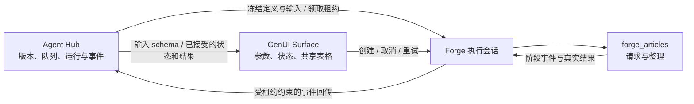

# Forge × Agent Hub 工作流基建

2026-10-22，当前未提交工作区实现。首条流程是「请求教学文章 → 筛选整理 → 表格结果」。后续新增功能可以先实现无页面依赖的核心工作流，再接入已有参数与结果组件。

## 职责



- Hub 新增隔离的 `learning_workflows` 控制面，SQLite 保存不可变版本、冻结输入、运行和有序事件。工程迁移/发布 Graph 保持独立。
- Forge `packages/forge_articles` 执行核心能力；Dio 教学模块共用文章请求。学习模块之间不直接依赖。
- `shared/workflows` 只负责 HTTP 传输；工作流实验室组合能力、GenUI 组件目录与运行会话。
- 当前 GenUI 使用明确的受限组件树，输入控件来自 Hub schema，状态通过 SDK DataModel 绑定，结果来自 Hub 已接受记录。这一步没有让模型生成流程或页面；已有「生成式实验工作区」仍承担真实模型学习演示。

## 使用

1. 在 `/Users/forest/code/agent-hub` 启动服务：

   ```bash
   PYTHONPATH=src .venv/bin/python -m agent_hub.learning_workflows.server \
     --state /tmp/forge-workflows.sqlite3 --token-file /tmp/forge-workflows.token
   ```

2. Forge 打开「UI 与动效 → 跨项目工作流实验室」（`/workflow-workbench`）。点击「连接 Agent Hub」，地址使用 `http://127.0.0.1:8768`，令牌填写上述文件内容。
3. 修改页码、数量和筛选词后运行。筛选 `admin` 可看到作者过滤；打开模拟失败再运行，可查看错误并关闭开关重试；增加延迟后可观察取消。
4. 展开「运行事件与历史」，查看原运行与重试的新 Run ID。退出页面会停止本执行端，运行记录保留在 Hub SQLite。重新进入会创建新执行端，旧记录仍可按原 ID 从 Hub API 查询。

服务默认仅监听本机，临时令牌只在页面内存保存；Ctrl-C 停止服务并删除本次令牌文件。再次启动使用新的令牌，SQLite 可继续沿用。首条流程始终使用合成教学文章，无外部模型或业务数据请求。

Hub 也可通过 `POST /v1/runs` 主动下发任务，使用页面显示的 executorId；页面每秒领取任务。接口和字段见 Agent Hub 的 `docs/learning-workflows.md`。当前只有页面打开期间执行，没有独立后台 Worker。

Web 连接需在服务启动时使用 `--allow-origin` 明确允许实际来源。HTTPS 页面连接 HTTP 本机服务还受浏览器策略限制；设备上的 `127.0.0.1` 指向设备自身。Web 构建通过不代表浏览器或移动设备的跨主机连通验收。

## 扩展顺序

1. 在独立包补充核心能力、输入/结果契约和取消行为，先无页面执行。
2. 在 Hub 增加新版本定义与显式支持的能力清单，在 Forge 增加执行器映射和必要结果组件。当前 v1 仅支持文章模板，不能只添加 JSON 就执行任意流程。
3. 用第二条实际流程检验共性，再引入节点编辑、字段映射与保存版本。此后再探索模型生成受校验流程；任何结果仍由执行器产生。

尚未实现：低代码画布、任意 DAG、用户自定义代码、持久执行端身份、后台执行、多租户及模型编排。协议幂等、租约和状态校验已具备；传输断连后由 Hub 超时结算，不宣称可靠的跨进程自动续跑。

## 验证

本次真实 macOS + 本机 Hub 验收覆盖成功、Hub 外部下发、失败保留、关联重试、远端取消；取消后整理步骤未启动。原始运行记录见 [工作区证据](evidence/workflow_ecosystem_20261022/runs.json)。其他平台实际操作单独验收。

Hub 定向测试命令见其文档。Forge 核心能力测试位于 `packages/forge_articles/test`；页面测试覆盖 360dp / 1.4 倍文字和排队超时恢复；真实双端入口为 `apps/flutter_forge/integration_test/workflow_ecosystem_test.dart`，默认跳过。

真实联调使用临时的 0600 JSON 文件传入 `WORKFLOW_E2E=true` 与 `WORKFLOW_HUB_TOKEN`：

```bash
flutter test integration_test/workflow_ecosystem_test.dart -d macos --no-pub \
  --dart-define-from-file=/absolute/path/to/temporary-defines.json
```

令牌不进入证据文件或仓库；测试后删除临时配置。最终门禁与构建状态见同目录验收记录。
