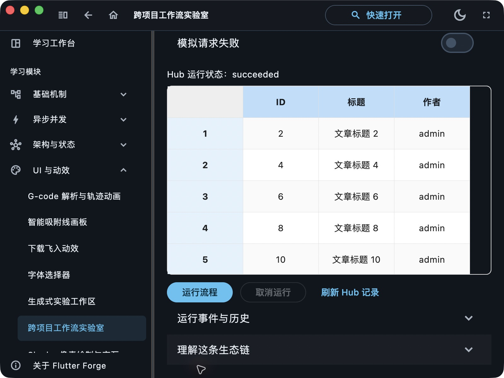

# 跨项目工作流验收

日期：2026-10-22。范围为当前未提交工作区，Forge 基于 `b501f21`，Agent Hub 基于 `535c907`；不代表发布版本或所有平台验收。

| 检查 | 状态与范围 |
| --- | --- |
| Hub 定向单测 | PASS，7 项，包含 SQLite 重开、版本不可变、幂等、租约、事件顺序、取消/超时、并发领取和真实本机 HTTP 认证/来源 |
| 真实跨项目运行 | PASS，macOS Forge + 本机 Python Hub；成功、外部下发、失败、关联重试、远端取消共 5 次运行 |
| 桌面手动操作 | PASS，正常应用入口连接 Hub，输入 admin，完成并显示 5 行真实合成数据结果；截图见下 |
| 热重载 / 运行错误 | PASS，Dart MCP 热重载成功，手动运行后未发现 runtime errors |
| Web 构建 | PASS，`bash tool/build_web_release.sh`，包含本地 CanvasKit 与加载壳检查；浏览器连通未验收 |
| 完整门禁 | PASS，`bash tool/quality_gate.sh`：生成物无漂移、格式、bare analyze 无 issue、workspace 全量测试、工具测试、32 个模块测试存在性 |
| Windows / Android / iOS 实际操作 | UNVERIFIED |

真实集成运行记录见 [runs.json](runs.json)，不含访问令牌或执行租约。取消案例在 fetch 阶段结束，未启动 organize。页面测试另覆盖 360dp、1.4 倍文字及 Hub 排队超时后的恢复；核心包可无 Widget 执行。

本轮数据为固定合成教学文章，不调用模型或外部业务服务。桌面截图与自动化运行分别使用不同的执行端，截图不冒充同一次 Run 的证据。测试服务和临时令牌在验收后停止/删除，启动方法见 [使用文档](../../WORKFLOW_ECOSYSTEM_FOUNDATION.md)。

已知边界：只有当前页面在线期间执行；SQLite 保留旧记录，但新页面生成新 executorId；固定文章流程，不支持任意 DAG 或节点画布。Web 构建验收不等于浏览器连通验收。未提交、未推送。
