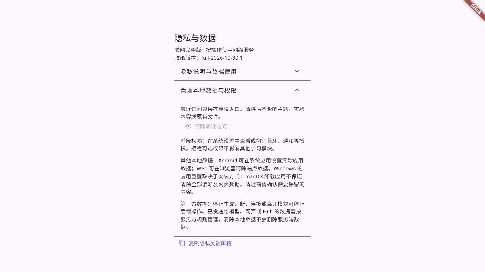

# 分发与隐私管理落地记录

范围：当前未提交工作区，起点 HEAD `4a9f1576ec4abc41ae3f42a0bae109adb27dd71f`。保留原有 Windows runner、UI 验收工具、报告和 release/1.2.10 产物；未提交、推送、部署、构建新的 Android/Windows 分发包或操作商店发布。

## 实现

- `docs/distribution/catalog.json` 维护发行配置、渠道优先级、冻结产物及提交记录；后台审核/发布只在追加的 observations 中登记，超过 7 天显示待核对。`OVERVIEW.md` 为自动生成总览。
- `tool/distribution.py` 提供 validate/generate/check/register/prepare；导入实际文件 hash 与构建报告，准备新目录中的提交材料 JSON 和缺口清单，无上传/提交/发布实现。
- 已登记四端 GitHub 1.2.10+4 和 vivo 2006 本地清单。旧包政策绑定未知，后台状态未知，历史 manifest 不回填新政策。密钥未读取或写入台账，Android 仅登记证书公开指纹。
- `docs/privacy/policies.json` 为共用条款与两版正文的唯一来源；生成 Dart 常量、稳定 HTML、版本 HTML、正文/HTML hash 索引。归档原有 10/28 与 10/29 文本，当前两版为 `*-2026-10-30.1`。同版本修改或历史 HTML 改写会失败。两条旧导出命令兼容并均支持 `--check`。
- 关于页统一“隐私与数据”，展示政策版本、权限与分平台数据控制说明；仅提供已实现的最近访问清除，不清除主题、实验、文件或第三方数据。串行清除偏好与访问写入，保存失败不展示成功。模型发送前提示保留，未新增统一首启同意弹窗。
- vivo 后续构建显式指定递增 versionCode、验证登记证书、写入新目录并附政策绑定；Windows MSIX 与四端新 release manifest 增加发行配置/政策元数据。正式 Store MSIX 的商店签名与 LocalTest 分开判断；没有改变既有 CI/门禁脚本语义或发布执行器。

## 验证与证据边界

- 两版政策及历史生成一致性检查通过；管理工具专项 13 项通过，自动化 catalog 已登记 `distribution-tests`。
- Windows MSIX 工具单测/preview 11 项通过；不代表 Windows 构建、安装、WACK 或商店验收。
- 隐私 Widget/逻辑测试 4 项通过，含 360px 展开、清除范围、持久化与后续访问顺序。
- `FORGE_OFFLINE=true` 定向回归 6 项通过；仅 Widget/逻辑，不代表 Android 真机。
- 按原锁文件重新解析后完整 `bash tool/quality_gate.sh` 五阶段通过：生成契约、格式、bare analyze、workspace/tool tests、模块测试存在性。锁文件未保留依赖或镜像 URL 改动。
- 360px 宽内容容器的本机 Web 组件预览可读，管理说明展开后无横向溢出，清除 fixture 最近访问后按钮禁用并显示成功反馈。此为当前组件预览，不是完整宿主或商店安装包验收。DTD 热重载成功。
- Web Release 本地构建通过，两个稳定页面与四个历史页面均随包提供，六份 HTML 与源逐字节一致。构建有 CupertinoIcons 字体提示，未据构建结果宣称所有页面视觉通过。
- 本机 vivo 开发者首页显示未登录，未进入应用后台。没有重新核定 2006 是否待审/通过/上架，全部保持待核对。
- 旧 2006 提交准备 dry run 返回 blocked，列出未知政策绑定、dirty 来源、身份/宿主/公开 URL/素材证据缺口；此为准备材料结果，不撤销其历史测试或提交，也不证明当前商店拒审。

日志在本机 `/private/tmp/forge-distribution-quality-locked.log`、`forge-privacy-widget.log`、`forge-distribution-offline.log`、`forge-distribution-msix-final.log`、`forge-distribution-tests-verified-20261030/result.json`；日志不是长期跨主机验收凭证。

## 待真实环境继续的事项

1. 登录 vivo 只读核对 2006，登记后台观察、实际政策 URL、素材与发布设置；不从旧本地记录猜测状态。
2. Microsoft Store 填正式身份并完成 Windows 主机专项、WACK 与正式候选包材料；仍需单独授权提交。
3. 部署后核对两版稳定 URL 和历史 URL 的实际内容，再登记版本/hash/核对时间；本地生成与构建不代表上线。
4. 下一次实际发包重新冻结产物。当前源码、生成文本和预览不会更新已分发的旧包。
